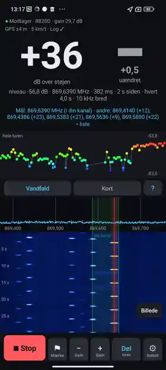
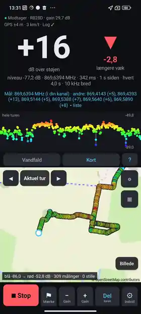
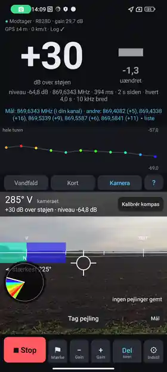
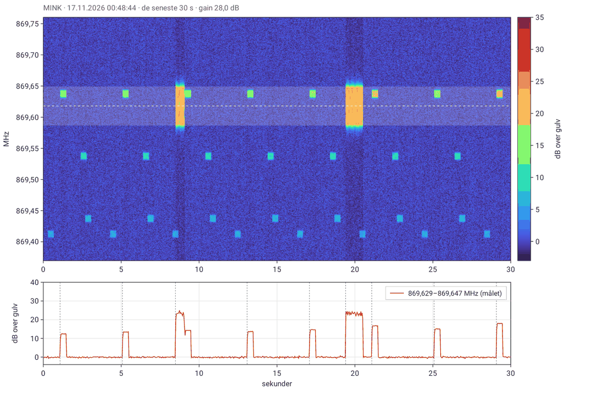

# MINK – Mesh-INterferens-Kortlægger

MINK er det værste akronym, vi kunne finde på: **M**esh-**IN**terferens-**K**ortlægger, hvor halvdelen af bogstaverne kommer fra samme ord. Appen er bedre end navnet.

Den gør en Android-telefon og en RTL-SDR til et håndholdt instrument, der finder smalle forstyrrelser i og omkring en LoRa-mesh-kanal. Du ser, hvad der er i båndet, vælger det signal, du vil gå efter, og kører eller går rundt, mens appen måler, logger og tegner kort.

Baggrunden står i artiklen [MINK finder forstyrrelser på en mesh-kanal](https://intraon.dk/nyheder/mink). Netværket, appen blev lavet til, er beskrevet på [MeshCore i Herning](https://intraon.dk/toolbox/meshcore).

> **English summary.** MINK turns an Android phone and an RTL-SDR dongle into a handheld tool for finding
> narrowband interference in and around a LoRa mesh channel (MeshCore EU/UK narrow by default). It shows a
> waterfall, tracks the signal you pick, logs every burst with GPS position, draws a heat map, saves the waveform
> (IQ) for later analysis, and supports a directional antenna with compass bearings and a camera overlay.
> The user interface, code comments and documentation are in Danish. MIT licensed.

  
  &nbsp;&nbsp;
  
  &nbsp;&nbsp;
  

Optaget på en tur med appen: vandfaldet, kortet og kameraet. Tryk på et billede for at se videoen i fuld størrelse på <a href="https://intraon.dk/nyheder/mink">intraon.dk</a>.

  

Målebilledet er lavet med appens egen kode og simulerede signaler.

## Hvad den kan

- **Vandfald** over hele det lyttede bånd, med din egen kanal markeret. Tryk på et signal for at gøre det til målet.
- **Styrke, pil og bip** for målet: tallet er dB over støjen, pilen viser, om du kommer tættere på, og tonen stiger med styrken.
- **Log med position** for hver måling, og et punkt hvert 10. sekund for, om der var stille.
- **Kort og varmekort**, også for tidligere ture. Kortet kan gemmes som billede.
- **Se en tur igen**: en liste over ture, og turens vandfald genskabt fra loggen med det ægte signal i hvert udbrud.
- **Bølgeformen** (IQ) af hvert signal gemmes, så modulation og bitrate kan undersøges bagefter.
- **Donglens frekvensfejl** rettes med ét tryk ud fra trafikken på din egen kanal.
- **Retningsantenne**: kompasretning på hver måling, kameravisning med farvebånd langs horisonten, og pejlinger som streger på kortet.
- **Målebillede**: en figur af de seneste 30 sekunder til at dokumentere en forstyrrelse.
- **Del** log, bølgeform og billeder fra en tur, enkeltvis eller som én zip-fil.

Bredbåndet trafik som LoRa fra MeshCore, Meshtastic og LoRaWAN sorteres fra; MINK leder efter det smalle, der ikke hører hjemme.

## Det skal du bruge

- Android 10 eller nyere.
- En RTL-SDR (R820T eller R828D) og et USB-OTG-kabel.
- Appen **Rtl-sdr driver** (`marto.rtl_tcp_andro`) fra Play Butik. MINK tilbyder selv at hente den.

## Installation

Hent `MINK.apk` fra [den nyeste udgivelse](../../releases/latest), åbn filen på telefonen, og tillad installation fra den kilde, du hentede den med. Appen ser derefter selv efter nye versioner.

## Kom i gang

1. Sæt donglen i telefonen, og tryk **Start**.
2. Se vandfaldet. Det grønne felt er din kanal.
3. Tryk på det signal, du vil finde. Den røde linje viser målet.
4. Følg tallet, pilen og bippet, mens du bevæger dig. Fanen **Kort** viser, hvor signalet er stærkest.
5. Tryk **Del**, når turen er slut.

Første gang viser appen en kort vejledning; den ligger også bag **?** ved fanerne. Hele brugervejledningen står i [docs/brug.md](docs/brug.md).

## Filer på telefonen

| Mappe | Indhold |
|---|---|
| `Download/mink/` | Turens log (`mink_<tid>.jsonl.txt`), bølgeformen (`mink_<tid>.iq.wav`) og zip-filer fra **Del** |
| `Pictures/MINK/` | Målebilleder, kortbilleder og pejlingsfotos |

Formaterne er beskrevet i [docs/logformat.md](docs/logformat.md).

## Opdatering og privatliv

Appen spørger GitHub, om der er udgivet en nyere version, højst to gange i døgnet og aldrig mens der måles. Android spørger dig, før en opdatering installeres, og installerer kun en APK, der er signeret med samme nøgle som den installerede. Tjekket kan slås fra under ⚙ → Om MINK.

Alt andet bliver på telefonen. Log, bølgeform og billeder sendes kun videre, når du trykker **Del**, eller hvis du selv har skrevet en webhook-adresse under ⚙. Kortfliserne hentes fra OpenStreetMap.

## Byg selv

Kræver JDK 17 eller nyere. Første gang henter scriptet Android SDK'et (ca. 1 GB).

| Maskine | Kommando i repoets rod | Resultat |
|---|---|---|
| Linux og Mac | `sh tools/build.sh` | `dist/MINK.apk` |
| Windows (PowerShell) | `.\tools\build.ps1` | `dist\MINK.apk` |

Scriptet kører unittestene først; fejler de, bygges der ingen APK. Uden en signeringsnøgle (`keystore.properties`, se [docs/arkitektur.md](docs/arkitektur.md)) signeres der med Androids debug-nøgle. En sådan APK kan ikke installeres oven i en udgivet version.

## Dokumentation

| Dokument | Indhold |
|---|---|
| [docs/brug.md](docs/brug.md) | Brugervejledning: skærmen, målet, kortet, retningsantenne, deling og indstillinger |
| [docs/arkitektur.md](docs/arkitektur.md) | Kodens opbygning, mapperne, trådene, byg og udgivelse |
| [docs/signalbehandling.md](docs/signalbehandling.md) | Hvordan signaler findes og måles, gain, frekvensrettelse og retninger |
| [docs/logformat.md](docs/logformat.md) | Logfilen, bølgeform-filen og webhook-formatet |
| [CONTRIBUTING.md](CONTRIBUTING.md) | Sådan bidrager du, også med en AI-assistent |

## Licens og tredjepart

MINK er udgivet under MIT-licensen, se [LICENSE](LICENSE). © 2026 JOHANSEN CONSULT ApS (Intraon), [intraon.dk](https://intraon.dk).

- Kortet tegnes med [osmdroid](https://github.com/osmdroid/osmdroid) (Apache-2.0).
- Kortdata er © OpenStreetMap-bidragyderne (ODbL).
- Donglen åbnes af appen "Rtl-sdr driver", som installeres for sig og ikke er en del af MINK.
